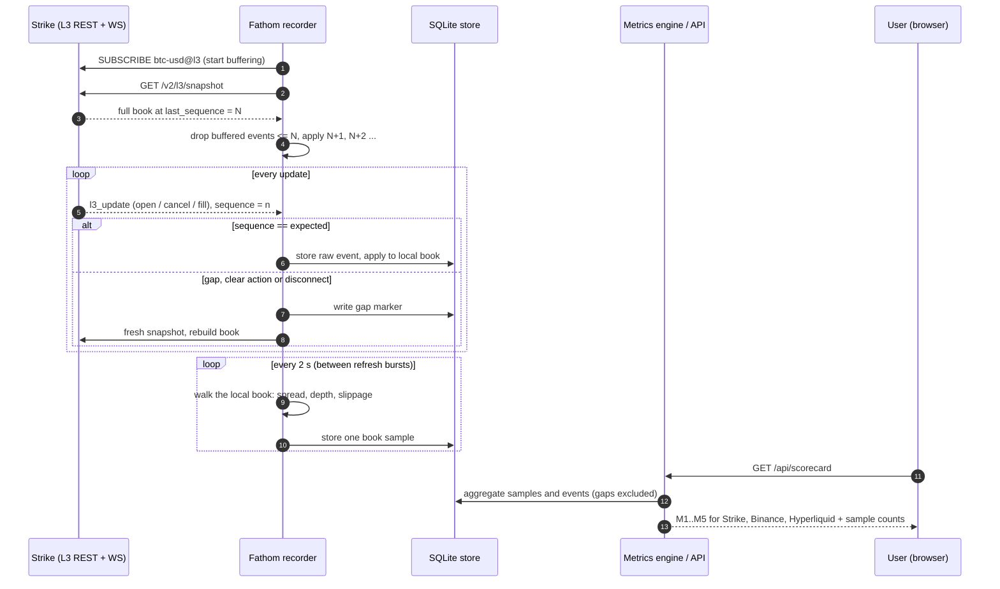

# Fathom: the Strike market quality index

> **How deep is Strike's book?**
> Fathom records Strike's public **L3** (every resting order) BTC-USD feed around the clock, measures its liquidity quality the
> same way as Binance and Hyperliquid, and publishes the result as a live scorecard, an open dataset and a read-only API.

Everything here runs on **live public market data**. There is no mock data, no simulated order book and no seeded numbers.
The one model in the product (the incentive designer) is a clearly labelled what-if. See [FEEDBACK.md](FEEDBACK.md) for the
architectural pain point in Strike's L3 feed that this project surfaced, with evidence and a proposed fix.

---

## 1. The idea

**The problem.** Strike's perps volume is thin (roughly $0.3M a day on DefiLlama). Thin books mean slippage. Slippage keeps traders
and market makers away, and that keeps the books thin. Nobody outside Strike has an independent, public number for *how* thin the book
is, *versus whom*, or *whether a liquidity programme works*.

**The insight.** Strike publishes something almost no exchange does: a public **Level 3** feed, i.e. every individual resting order
with its FIFO position. L2 only tells you "$X at this price". L3 also tells you who is quoting, how long quotes live, what gets cancelled
and what actually trades. That is enough to measure liquidity *quality*, not just size.

**The product.** Fathom turns that feed into:

| What | For whom | Where |
| --- | --- | --- |
| A live **scorecard**: spread uptime, depth, slippage at size, cancel/fill, depth resilience, next to Binance and Hyperliquid | Strike team, traders, judges | `/scorecard` |
| An **incentive designer**: "if we paid a 1 bp maker rebate to 3 Quoters, what would depth and slippage look like?" | Strike team sizing STRIKE spend | `/designer` |
| An **open dataset** (Parquet) and a **read-only API** with every outage marked | Builders, market makers | `/data`, `/api/*` |
| A one-page **methodology** with every definition and known limit | Anyone who wants to check our work | `/methodology` |

**The pitch.** *"Strike's problem is thin liquidity. This tells the team exactly how thin, versus whom, and what a rebate or Quoter
programme would buy, before they spend STRIKE on it."*

**What it is not.** No trading, no wallets, no funds, no predictions, BTC-USD only (the only symbol with public L3), and no claim about
exchange integrity. It measures liquidity, not honesty.

---

## 2. How it works at a glance

```
   PUBLIC FEEDS                       FATHOM RECORDER (one process, 4 tasks)                    STORE
 ┌────────────────────┐            ┌──────────────────────────────────────────┐          ┌──────────────┐
 │ Strike L3          │──snapshot─▶│ strike_l3   sync + gap detection         │──events─▶│              │
 │  REST + WebSocket  │──stream───▶│             local L3 book, 2 s samples   │──samples▶│              │
 ├────────────────────┤            ├──────────────────────────────────────────┤          │   SQLite     │
 │ Strike market WS   │──trades───▶│ strike_market  trade tape, bookTicker    │──────────▶│   (WAL)      │
 ├────────────────────┤            ├──────────────────────────────────────────┤          │              │
 │ Binance depth      │──stream───▶│ binance     local book, 1000-lvl snapshot│──samples▶│  l3_events   │
 ├────────────────────┤            ├──────────────────────────────────────────┤          │  book_samples│
 │ Hyperliquid l2Book │──stream───▶│ hyperliquid two granularities            │──samples▶│  snapshots   │
 └────────────────────┘            └──────────────────────────────────────────┘          │  gaps        │
                                                                                          └──────┬───────┘
                                                                                                 │ read-only
        ┌────────────────────────────────────────────────────────────────────────────────────────┤
        ▼                                         ▼                                              ▼
 ┌───────────────┐                       ┌─────────────────┐                           ┌──────────────────┐
 │ Metrics engine│──M1..M5 per window───▶│  FastAPI :8000  │──JSON────────────────────▶│ Next.js frontend │
 │  (rollups)    │                       │  /api/*         │                           │  scorecard,      │
 └───────────────┘                       │  Parquet export │──files───────────────────▶│  designer, data  │
                                         └─────────────────┘                           └──────────────────┘
```

### 2.1 Sequence diagram: from a Strike order to a number on the scorecard



### 2.2 The recorder state machine (why a gap can never corrupt a number)

```
                     ┌────────────────────────────────────────────┐
                     │                CONNECTING                  │
                     │  open WebSocket, send SUBSCRIBE, buffer    │
                     └───────────────────┬────────────────────────┘
                                         ▼
                     ┌────────────────────────────────────────────┐
                     │                 SNAPSHOT                   │
                     │  GET /v2/l3/snapshot  -> book at seq N     │
                     └───────────────────┬────────────────────────┘
                                         ▼
                     ┌────────────────────────────────────────────┐
                     │                 SYNCED                     │◀─────────┐
                     │  expect seq N+1, N+2 ... apply + store     │          │ next event
                     └───────┬──────────────┬──────────────┬──────┘          │ seq == expected
              seq > expected │   `clear`    │  disconnect  │                 │
                             ▼   action     ▼  / error     ▼                 │
                     ┌────────────────────────────────────────────┐          │
                     │             GAP: write marker              │          │
                     │  start = last event time, reason recorded  │          │
                     │  back-off 1,2,4 .. 30 s, then CONNECTING   │──────────┘ (marker closed at next snapshot)
                     └────────────────────────────────────────────┘
        Process restarts are also gaps: the previous heartbeat time opens a marker.
        Metrics never interpolate across a gap; coverage is shown beside every number.
```

### 2.3 How one metric sample is made (walking the book)

```
   ASKS (lowest first)                     mid = (best bid + best ask) / 2
   $81,023  0.40 BTC   ────┐               spread = (ask - bid) / mid
   $81,021  0.10 BTC       │ buy $50k      depth within N bps = sum(price x size) for levels inside mid +- N bps
   $81,020  0.35 BTC   ────┘ walks up      slippage = (average fill price - mid) / mid
   ───────── mid $81,019.5 ─────────
   $81,019  0.30 BTC   ────┐ sell $50k
   $81,018  0.12 BTC       │ walks down    If the visible book cannot fill the order the sample is excluded
   $81,016  0.25 BTC   ────┘               from the average and the fill share is reported instead.
   BIDS (highest first)                    Benchmarks use the identical code (fathom/ladder.py).
```

### 2.4 What the user sees (page flow)

```
  /  (landing)  ──────────────▶  /scorecard  ─── window: 15 m | 1 h | 6 h | 24 h
   hero: live book art            ├─ "Strike, in its own terms"   M1..M4 cards, change vs previous window
   what does a $50k order         ├─ trend charts (3 h / 12 h / 48 h), gaps drawn as gaps
   cost right now?                ├─ "Versus Binance and Hyperliquid"  table + comparison charts
   findings carousel              ├─ "What only L3 shows"  placed / cancelled / filled, M5 resilience
        │                         └─ "Data behind these numbers"  hours recorded, coverage, gaps
        ├──────────────────────▶  /designer   rebate, Quoters, size  ──▶ modelled depth + slippage (banner: what-if)
        ├──────────────────────▶  /methodology  every definition, data window, known limits
        └──────────────────────▶  /data        Parquet files per table per day + schema + query endpoint
```

---

## 3. The metrics

All values are computed on a 2-second clock from the full local book and rolled up to 1-minute, hourly and daily windows.
Every number is shown with its sample count; recording gaps are excluded, never interpolated.

| # | Metric | Definition | Strike | Binance / Hyperliquid |
| --- | --- | --- | --- | --- |
| M1 | Spread uptime | Share of samples with a two-sided book and spread <= 5 bps | L3 book | L2 book |
| M2 | Depth within N bps | USD resting within 5, 10, 25 bps of mid, per side | L3 book | L2 book (n/a where the feed does not reach) |
| M3 | Slippage at size | Cost vs mid of a $10k / $50k / $100k market order, by walking the book | L3 book | L2 book |
| M4 | Cancel / fill | Cancelled size over filled size, plus counts of placed, cancelled, filled | L3 events | not available |
| M5 | Depth resilience | Time for depth within 10 bps to recover to 80% after a taker order above $10k | L3 events | not built |

M6 (flow toxicity) was cut first, as the PRD allowed.

---

## 4. Using the app

### 4.1 If you are on the Strike team (is our book healthy, and what would a programme buy?)

1. Open **/scorecard**. Pick a window (1 hour is the default). The four cards at the top are Strike on its own: spread uptime, depth
   within 10 bps, slippage for a $50k order and the cancel/fill ratio, each with the change against the window before it.
2. Scroll to **"Versus Binance and Hyperliquid"**. The gap is the size of the opportunity, not a verdict. `n/a` means the venue's public
   feed does not reach that price band; Fathom never extrapolates.
3. Open **/designer**. Enter a maker rebate (bps), the number of Quoters and each Quoter's quote size. Press *Model on the live book*.
   Read the table (recorded book vs modelled) and the printed assumptions. The banner reminds you this is a what-if, not a forecast.
   Change the assumed adverse-selection cost to see how sensitive the result is.
4. Open **/data** to download the evidence behind any number.

### 4.2 If you are a market maker or Quoter

Look at **depth within 5/10 bps**, **slippage** and the **"What only L3 shows"** section: how many orders are placed versus cancelled versus
filled, and how quickly depth returns after a large taker order (M5). The findings carousel on the landing page summarises it.

### 4.3 If you are a trader or builder

- On the landing page use the widget *"What does a market order cost right now?"*: pick $10k, $50k or $100k and compare Strike, Binance
  and Hyperliquid on the latest 2-second sample.
- Pull data programmatically:

```bash
# current health of the four feeds
curl http://localhost:8000/api/health

# scorecard for the last 60 minutes (all venues)
curl "http://localhost:8000/api/scorecard?window_minutes=60"

# metric values for a time range (unix ms), 1-minute buckets
curl "http://localhost:8000/api/query?start=1792700000000&end=1792703600000&step=minute"

# what the incentive model says (POST)
curl -X POST http://localhost:8000/api/designer -H "content-type: application/json" \
     -d '{"rebate_bps":1,"n_quoters":3,"quote_size_usd":50000}'

# list the Parquet files, then download one
curl http://localhost:8000/api/dataset
curl -O http://localhost:8000/api/dataset/gaps.parquet
```

### 4.4 API reference

| Endpoint | Returns |
| --- | --- |
| `GET /api/health` | per-feed heartbeat age and ok flag |
| `GET /api/coverage` | hours recorded, sample coverage and gap time per venue |
| `GET /api/gaps` | every marked gap (venue, start, end, reason) |
| `GET /api/scorecard?window_minutes=` | latest and previous window for every venue, M4, and since-start values |
| `GET /api/series?venue=&step=&hours=` | time series of M1 to M3 |
| `GET /api/query?start=&end=&step=` | the read-only metric-range endpoint from the PRD |
| `GET /api/cancel_fill?step=&hours=` | M4 series |
| `GET /api/resilience?hours=&min_usd=` | M5 events and median recovery |
| `GET /api/latest`, `GET /api/book` | latest sample per venue; latest Strike book levels |
| `POST /api/designer` | the what-if model on the current recorded book |
| `GET /api/dataset`, `/api/dataset/{file}`, `/api/dataset/schema` | Parquet export and schema |

Interactive docs are served at `/docs`.

---

## 5. Run it yourself

Prerequisites: Python 3.11+, Node 20+. No API keys, wallets or accounts are needed: every feed is public.

```bash
# 1. backend
pip install -r requirements.txt
python -m fathom.recorder        # starts all four recorders, writes data/fathom.db
python -m fathom.api             # API on http://localhost:8000  (docs at /docs)

# 2. frontend
cd web
npm install
npm run build && npx next start -p 3002     # or: npm run dev
# the frontend reads NEXT_PUBLIC_API_URL (web/.env.local); default http://localhost:8000
```

The recorder must run continuously. Strike has **no history endpoint**, so every hour it is down is a permanent, marked gap.
`run_recorder.cmd` restarts it if it exits; `deploy/*.service` and `docker-compose.yml` run it on a server.

Configuration lives in `.env` (see `.env.example`). Everything the product reads is public; the pending section lists only deployment
values you supply.

### 5.1 Verify our work

```bash
python -m fathom.verify           # sequence continuity, replay vs REST checkpoints, bookTicker cross-check
python -m fathom.verify --live    # sync a fresh book, run 30 s, diff against a brand-new REST snapshot
python -m pytest tests            # arithmetic tests + tests on recorded real data
python -m fathom.analyze_churn    # reproduces every number quoted in FEEDBACK.md
```

What these show today: the rebuilt L3 book matches Strike's REST snapshots order for order in all checkpoint replays (zero mismatches,
zero sequence holes), a deliberately dropped real event is shown to corrupt the book (which is why any gap forces a rebuild), and
100% of L3 fills recorded while the market feed was connected appear on Strike's public trade tape.

---

## 6. Strike interactions (what we call, and why)

| Strike interface | Use in Fathom |
| --- | --- |
| `GET /v2/l3/snapshot?symbol=BTC-USD` | full book at a sequence: at every session start, and every 10 minutes as a verification checkpoint |
| `wss://api.strikefinance.org/ws/l3` (`btc-usd@l3`) | every order-level update; buffered, then applied from `last_sequence + 1` |
| `wss://api.strikefinance.org/ws/price` (`trade`, `bookTicker`) | public trade tape and top of book, to cross-check the rebuilt book |

Limits respected: one L3 connection, one market connection, one snapshot every 10 minutes (the limit is 10 per second). No
authentication is involved.

---

## 7. Repository layout

```
fathom/            Python package
  strike_l3.py       L3 recorder: snapshot + stream sync, gap detection, local book, burst-aware sampling
  strike_market.py   trade tape + bookTicker
  binance.py         Binance depth book (futures when reachable, else the public spot mirror; logged)
  hyperliquid.py     Hyperliquid l2Book at two granularities
  book.py            local L3 book          ladder.py   metric arithmetic (same code for every venue)
  metrics.py         rollups, M4, M5        designer.py the labelled what-if model
  api.py             read-only FastAPI      export.py   Parquet export
  verify.py          replay + cross-checks  analyze_churn.py  reproduces FEEDBACK.md evidence
tests/             arithmetic tests and tests on recorded real data
web/               Next.js frontend (landing, scorecard, designer, methodology, dataset)
docs/DATASET.md    dataset schema
deploy/            systemd units          Dockerfile, docker-compose.yml
FEEDBACK.md        the pain point we found in Strike's L3 design, with evidence and a proposed fix
```

---

## 8. Honest limits

- **History starts when the recorder started**, and the laptop it ran on slept twice, so some hours are marked gaps. Hours recorded and
  coverage are shown on the scorecard and at `/api/coverage`.
- **BTC-USD only**, because that is the only symbol with public L3.
- **Strike volume is very thin.** Fills are rare (about 1,000 in the dataset), so cancel/fill and depth resilience rest on small samples.
  Sample sizes are printed beside every number.
- **Benchmarks are different instruments.** Binance is the USD-M perpetual when reachable and otherwise the public spot mirror (every
  switch is logged and shown). Hyperliquid streams only 20 levels per side, so wide depth bands are `n/a`.
- **Strike's book is sampled between refresh bursts.** Strike refreshes its whole book once a second as ~190 unbracketed events; sampling
  mid-burst understated Strike badly (spread uptime 86% vs 100%). Strike samples are taken at quiet moments and the history was rebuilt from
  the raw events. This is the finding written up in [FEEDBACK.md](FEEDBACK.md).
- **Visible liquidity only.** L3 shows resting orders, not intent; orders can disappear before a taker reaches them. That last point is the
  subject of [FEEDBACK.md](FEEDBACK.md).
- **The designer is a model**, not a forecast, and says so on the page.
